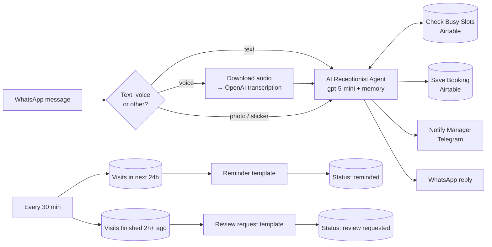
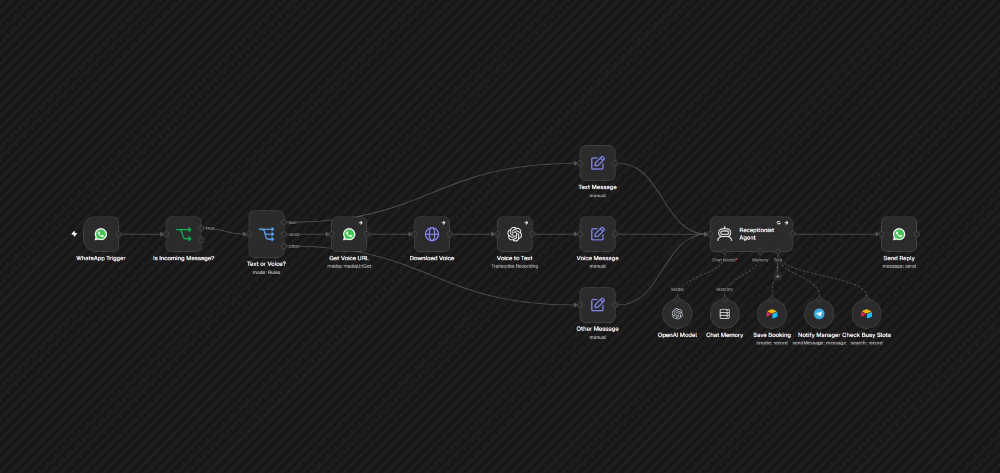
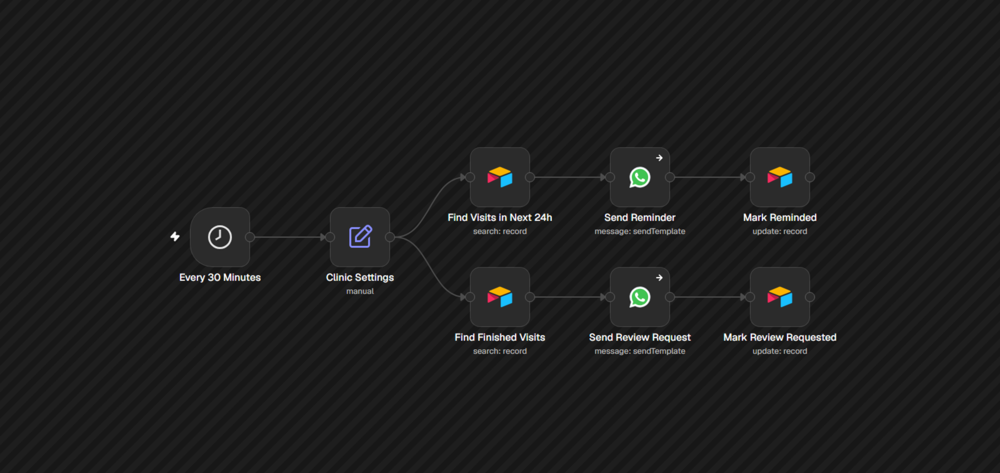

# WhatsApp AI Receptionist for Clinics

An AI administrator for a dental clinic on WhatsApp. It answers text **and voice messages** in Armenian, Russian or English, checks free time slots, books the visit into Airtable, notifies the manager in Telegram — and later sends an automatic reminder before the visit and a review request after it.

Built with **n8n**, the **WhatsApp Cloud API** and **OpenAI**. Demo company: "Smile Demo Clinic" (fictional).

🎬 **Demo video (30 s, Armenian):** [1-whatsapp-receptionist-hy.mp4](https://czibuahmksmifbzapnkv.supabase.co/storage/v1/object/public/smm-images/videos/1-whatsapp-receptionist-hy.mp4)

---

## Problem

Small clinics in Yerevan get most questions on WhatsApp: prices, opening hours, "can I come tomorrow at 3?". The administrator is busy with patients during the day and offline at night, so messages wait for hours and some clients simply book somewhere else. Patients also forget visits, and happy patients rarely leave reviews unless someone asks.

## Solution

Two n8n workflows:

1. **Receptionist** — replies to every incoming WhatsApp message within seconds, 24/7, and books the visit only into a time that is really free.
2. **Reminders & reviews** — every 30 minutes sends approved WhatsApp templates: a reminder for visits in the next 24 hours and a review request 2 hours after the visit.

## How it works



## Features

- Replies in the client's language (Armenian / Russian / English), short and friendly
- **Voice notes** are transcribed with OpenAI and handled like text
- Remembers the conversation per phone number (last 12 messages)
- Converts "tomorrow", "on Tuesday" into real dates in Yerevan time
- **No double booking:** checks Airtable for busy slots and offers the nearest free times
- Books only inside working hours and never in the past
- Manager gets a Telegram message for every booking, cancel or reschedule request
- Refuses off-topic requests, medical advice and prompt-injection attempts
- Fallback reply if the AI fails, so the client is never left without an answer
- Automatic reminders and review requests via approved WhatsApp templates; a failed send is marked (`reminder failed`) and does not block the others

## Tech stack

`n8n` · `WhatsApp Cloud API (Meta)` · `OpenAI gpt-5-mini` · `OpenAI speech-to-text` · `Airtable` · `Telegram Bot API`

## Repository structure

```
workflow/
  1-whatsapp-receptionist.json   # incoming messages → AI agent → booking
  2-reminders-and-reviews.json   # schedule → reminder / review templates
```

## Setup

1. **Import** both files from `workflow/` into n8n (*Workflows → Import from file*).
2. **Credentials** (all credentials were removed from the export — select your own on each node):
   - *WhatsApp OAuth* (for the trigger) and *WhatsApp API* (access token of a Meta System User)
   - *OpenAI API*
   - *Airtable Personal Access Token*
   - *Telegram Bot API*
3. **Airtable:** create a table for bookings with fields
   `Name`, `Phone`, `Service`, `Appointment At` (date-time), `Status`, `Language`, `Notes`.
4. **Replace the placeholders** in the workflows:

   | Placeholder | Where to find it |
   |---|---|
   | `YOUR_AIRTABLE_BASE_ID` | Airtable URL, starts with `app…` |
   | `YOUR_AIRTABLE_BOOKINGS_TABLE_ID` | Airtable URL, starts with `tbl…` |
   | `YOUR_TELEGRAM_CHAT_ID` | Your chat id (e.g. from @userinfobot) |
   | `YOUR_WHATSAPP_PHONE_NUMBER_ID` | Meta → WhatsApp → API Setup (node *Clinic Settings*) |
   | `https://g.page/r/YOUR-CLINIC/review` | Your Google review link |

5. **Meta / WhatsApp:**
   - Create a Meta app with the WhatsApp product, add a phone number.
   - Make sure the WhatsApp Business Account is **subscribed to your app** (`POST /{WABA_ID}/subscribed_apps`), otherwise the webhook receives nothing.
   - Create and get approval for two templates: `appointment_reminder_ru` (3 variables: name, service, date) and `review_request_ru` (2 variables: name, link) — or rename them in the nodes.
6. Edit the clinic info (hours, prices) in the system prompt of **Receptionist Agent**.
7. **Publish** both workflows and send a WhatsApp message to your number.

## Screenshots / video

- 🎬 Demo video: [watch](https://czibuahmksmifbzapnkv.supabase.co/storage/v1/object/public/smm-images/videos/1-whatsapp-receptionist-hy.mp4)

**Receptionist workflow**



**Reminders & reviews workflow**



## What I learned

- The WhatsApp trigger in n8n stays silent until the WABA is subscribed to the app — this took me the longest to find.
- Short-lived Meta tokens expire in a day; for production you need a **System User** token.
- Messages outside the 24-hour window can only be sent as **approved templates**, so reminders and review requests must be designed as templates from the start.
- An AI agent will happily book an already taken slot unless you give it a tool to check availability and a strict order of tool calls in the prompt.
- gpt models sometimes mix scripts in Armenian replies; an explicit "never mix languages" rule fixed most cases.
- Airtable search results in n8n are nested under `fields` (`$json.fields.Phone`, not `$json.Phone`).

---

Made by **Sergo Abrahamyan** — AI Automation Engineer, Yerevan · [LinkedIn](https://www.linkedin.com/in/sergo-abrahamyan-2b6290432/) · [GitHub](https://github.com/sergo-abrahamyan-ai)
